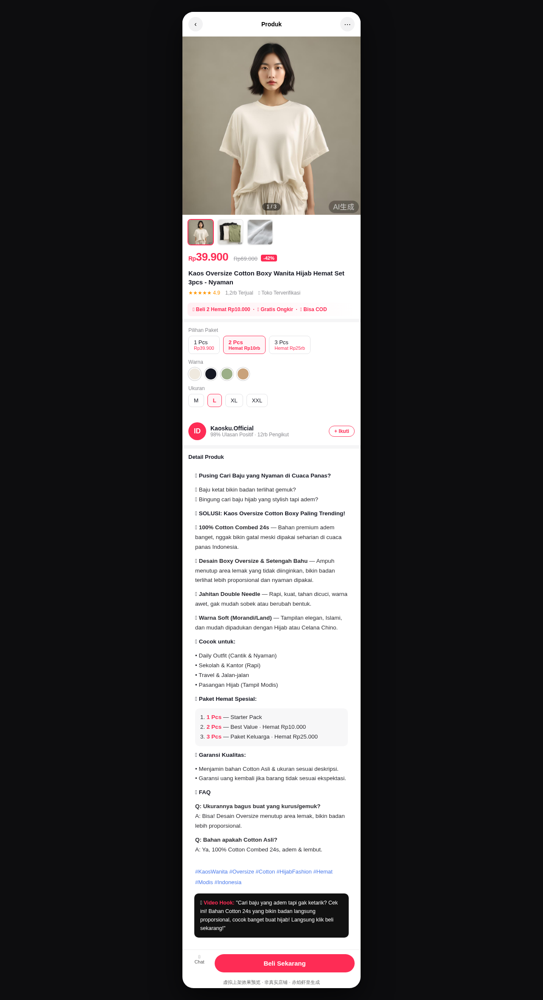

# 📈 TikTok 热榜采集器 · 本地四件套（tiktok-trending-kit）

> **一句话：** 在本机（Windows）跑一个脚本，**自动打开浏览器、登录你自己的 TikTok 账号、把某个国家/地区的热销榜、热门标签、热门音乐抓成一张表**，用来选品和跟趋势。

---

## 0. 三十秒看懂（小白先看这张表）

| 问题 | 答案 |
|---|---|
| **这是什么仓库** | 一个**采集工具**（不是网站、不是插件）。核心就一个 Python 脚本 `run_demo.py` |
| **做什么用的** | 抓 TikTok 官方「Creative Center」的公开榜单数据（商品/标签/音乐），导成表格，用于**跨境电商选品** |
| **给谁用** | 做 TikTok Shop / 跨境选品的个人卖家、运营、选品员 |
| **什么时候用** | 想找「印尼/泰国/越南…现在什么卖得好」，或者想验证某个品类的热度 |
| **不适用** | ① 刷播放量/点赞（本工具不干这个）② 抓私域/私信数据 ③ 大规模爬虫农场（有封号风险） |
| **怎么用** | 见第三节「四步跑通」 |
| **要什么条件** | Windows/Mac + Python 3.9+ + **你自己的 TikTok 账号** + 能访问 tiktok.com 的网络 |

---

## 一、仓库分类定位

| 项 | 值 |
|---|---|
| **领域分类** | 商业运营 → 跨境电商 → 选品工具 |
| **技术类型** | 本地脚本（Playwright 浏览器自动化）+ 一次性采集 |
| **产物类型** | 数据表格（CSV/JSON）+ 一个「虚拟上架效果图」预览页 |
| **使用者角色** | 卖家 / 运营 / 选品人员（**不需要会编程**，照着命令敲即可） |
| **适用行业** | 服装、美妆、家居、3C 配件等一切走 TikTok Shop 的品类 |
| **不适用行业** | 需要严格合规审查的金融、医疗类（平台本身限制） |
| **智能体可用性** | ⚠️ 仅供**人**在本地跑。云端不跑（本机内存红线），也不建议给无人工监督的智能体自动跑（会触发风控） |

---

## 二、文件说明

| 文件 | 是什么 | 要动吗 |
|---|---|---|
| `run_demo.py` | **主脚本**（自包含，10 KB，不依赖其他 .py） | ❌ 不改 |
| `config.json` | **配置**：地区、搜索词、滚动次数、采集上限 | ✅ 只改这里 |
| `requirements.txt` | 依赖清单（就一个：`playwright`） | ❌ 不改 |
| `SETUP.md` | 详细使用说明（含全部配置字段表） | 参考 |
| `index.html` | 结果预览页模板 | 不改 |
| `listing-preview-ID.html` | 「虚拟上架效果图」静态页 | 演示用 |
| `preview-ID.png` | 效果图截图 | 演示用 |
| `img/` | 商品图（AI 生成，仅演示） | 演示用 |

---

## 三、四步跑通（照抄就行）

### 第 1 步：装依赖

```bash
pip install -r requirements.txt
playwright install chromium
```
> 只需要装一次。第二条命令会下载 Chromium（约 150 MB）。

### 第 2 步：首次登录（只需一次）

```bash
python run_demo.py --login
```
浏览器会弹出来 → **手动登录你自己的 TikTok 账号** → 回到终端按回车。
登录态存在 `tk_profile/` 目录里，**以后不用再登录**（所以那个目录别删，也别外传）。

### 第 3 步：采集

```bash
python run_demo.py                # 默认：有头浏览器 + 印尼热销商品榜
python run_demo.py --headless     # 无头模式（登录态已存）
python run_demo.py --config th.json  # 换配置（例如泰国）
```

### 第 4 步：看结果

结果表格输出到终端/文件（见 `config.json` 的 `max_items` 控制条数）。
想看成「像真的在 TikTok Shop 里」的效果 → 打开 `listing-preview-ID.html`。

---

## 四、配置字段（改这些，不改代码）

| 键 | 说明 | 示例 |
|---|---|---|
| `preset` | 入口类型 | `creative_center_products`（热销品）/ `creative_center_hashtags`（热门标签）/ `creative_center_songs`（热门音乐）/ `tiktok_search` / `tiktok_discover` |
| `region` | 国家/地区码 | `ID` 印尼 / `TH` 泰国 / `VN` 越南 / `MY` 马来 / `PH` 菲律宾 / `SG` 新加坡 / `US` 美国 / `GB` 英国 |
| `query` | 搜索词（仅 `tiktok_search` 用） | `kaos oversize` |
| `url` | 自定义网址（填了就覆盖 preset） | `https://...` |
| `headless` | 无头模式 | `false`（首次）/ `true`（已登录） |
| `profile_dir` | 登录态目录 | `tk_profile` |
| `scroll_times` | 向下滚动次数（加载更多） | `8` |
| `card_selector` | 卡片 CSS 选择器（**留空 = 自动识别**） | `div[class*="product"]` |
| `max_items` | 最多采集条数 | `40` |

---

## 五、使用条件（缺一不可）

| 条件 | 说明 |
|---|---|
| **本地电脑** | 本工具设计为**本地跑**（云端内存仅 ~700 MB，跑不动浏览器）|
| Python | 3.9 及以上 |
| 依赖 | `playwright`（含 Chromium 内核，约 150 MB）|
| **TikTok 账号** | 需要你自己能登录的账号（榜单页需登录态）|
| 网络 | 能正常访问 `tiktok.com`（国内需合规网络环境）|
| 磁盘 | ≥ 500 MB 空闲 |

---

## 六、来源 · 许可 · 风险（必读）

| 项 | 说明 |
|---|---|
| 来源 | **自研**（赤焰虾皇为老板定制），无第三方代码 |
| 许可 | 私有 / 自用 |
| **风险 1：封号** | 自动化访问可能触发 TikTok 风控。**建议：低频、少量、别用主账号**。风险自担 |
| **风险 2：数据条款** | 抓取平台数据须遵守其服务条款；采集结果**仅供自己参考选品**，不得转售数据 |
| **风险 3：登录态泄露** | `tk_profile/` 内含你的登录 cookie。**绝不提交到 git、绝不外传**（已在 `.gitignore`）|
| **风险 4：榜单会变** | TikTok 前端改版会导致选择器失效。届时改 `card_selector` 或等更新 |
| 演示素材 | `img/` 与 `preview-ID.png` 为 **AI 生成 + 虚拟上架效果**，**非真实店铺**，仅看效果 |

---

## 七、附：虚拟上架效果预览（印尼 TikTok Shop）

> 用采集器定位品类后，由 `tkshop-sea.py` 生成详情页，再渲染成「像真在 TikTok Shop 里」的效果图。**非真实店铺，仅看效果。**



- 静态页面：[`listing-preview-ID.html`](listing-preview-ID.html)（下载后用浏览器打开）
- 商品图：`img/`（AI 生成，仅演示）

---

_维护人：赤焰虾皇 🦐 · 本 README 重写 2026-11-17（原 README 内容已完整保留于第七节）_